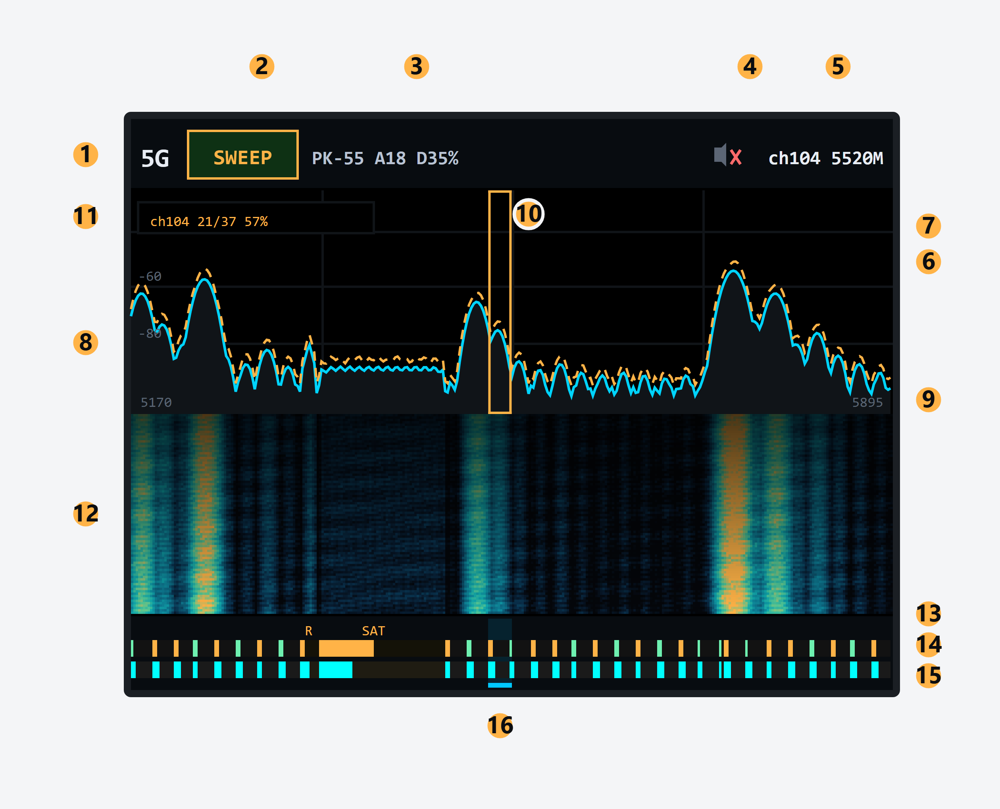

# ESP32-C5 本地频谱面板固件

`esp-sdr` 的 **lcd 分支**：把一块 ESP32-C5-DevKitC-1 变成**不依赖上位机**的
手持频谱仪——板上直接接一块 3.2 英寸 SPI 屏和 5 个按键，实时显示 2.4 GHz /
5 GHz 的频谱、瀑布和信道活动度。



（上图就是固件实际的界面布局，SWEEP 模式、选中 ch104；每个编号对应的元素见下面的
[界面](#界面)一节。图由 [docs/ui-guide.html](docs/ui-guide.html) 按固件里的真实坐标生成。）

## 硬件

| 部件 | 型号 | 备注 |
|---|---|---|
| 主控 | ESP32-C5-DevKitC-1（ESP32-C5HR8 rev v1.2） | 16 MB flash / 8 MB PSRAM / 48 MHz 晶振 |
| 屏幕 | 3.2" 240×320 SPI，**ST7789**（GMT032-8P-SPI） | 8 针：GND VCC SCL SDI RESET AO CS BL |
| 按键 | 5 个轻触 / 微动 | 对地、内部上拉、低电平有效 |
| 蜂鸣器 | 有源蜂鸣器 | 经 NPN（S8050）驱动，基极串 1 kΩ |

屏幕面板原生 240×320，固件默认横屏使用（MADCTL `0x60`，坐标空间 320×240），
按 R 可切回竖屏。

## 功能

**本地 UI**（不接电脑也能用）：顶栏、频谱、瀑布、底部信道条，逐元素说明见下面的[界面](#界面)一节。

**两种模式**

| 模式 | 行为 |
|---|---|
| `SWEEP` | 20 MHz 步进扫完整个频段，5 GHz 共 38 步，**一轮约 0.9 秒**（实测 42 步/秒） |
| `LIVE` | 锁定一个信道持续采集，频率轴显示当前 ±10 MHz |

**两个频段**

- 2.4 GHz：信道 1–13
- 5 GHz：真实信道表 36–64 / 96 / 100–144 / 149–165 / 169–173 / 177，
  底栏按实际中心频率贴边铺满，非等分处留空档

**没有信道号的频段也照样统计**

5 GHz 里几段不属于 Wi-Fi 的范围，和信道一样有活动度 / 检出率两条，
只是标签写成用途名：

| 范围 | 标签 | 说明 |
|---|---|---|
| 5330–5350 | `R` | 雷达专用（DFS 频段内部），约 9 px，放不下 `RADAR`，退回首字母 |
| 5350–5470 | `SAT` | 卫星主动遥感（Sentinel-1 SAR 中心 5405），约 53 px，完整单词 |
| 5730–5735 | — | 落在 ISM 带里的 5 MHz 缝隙，约 2 px，连一个字母都放不下 |

标签规则：整词放得下就写整词，放不下就退回首字母（`RADAR` → `R`）；
连首字母都放不下（宽度不足 7 px）时只保留两条信号条。

统计口径和信道完全一致：段内峰值减全段 20 分位底噪，超过 12 dB 算一轮检出。

**纵轴量程：4 套独立、全部固定**

2.4G / 5G × LIVE / SWEEP 各存一组上下限，写进 NVS，重启保留。
两种模式都**不做自动量程**，所以网格和曲线不会随信号强弱上下漂。
在哪个组合下调整，就只改那一个，另外三个互不影响。

**按键**

| 键 | 功能 |
|---|---|
| ← / → | 走信道（按住连发） |
| ← + → 同时 | 静音 |
| **B** | 切 2.4G / 5G |
| **M** | 切 LIVE / SWEEP |
| **R** | 转屏（短按）/ 恢复出厂（长按到倒计时结束） |
| **B** + ←/→ | 调当前组合的上限，5 dB 一格 |
| **M** + ←/→ | 调当前组合的下限，5 dB 一格 |
| **R** + ←/→ | 背光 10 % / 100 % 切换 |

组合键必须**先按 B/M/R 再按方向键**，反过来不生效。静音是切换式的，静音和
解除静音都会立即写入 NVS，重启后保持（长按 R 恢复出厂会取消静音，背光同时
回到 100 %）。调背光时顶栏右上角会临时显示 `B10%` / `B100%` 当前档位。

**仍然保留上位机协议**

UART0 2 Mbaud 或 USB-Serial-JTAG 上的 burst I/Q 与频谱命令照旧可用。
接上位机时本地 UI 自动切到 host 模式（顶栏出现 USB 标记，频率轴变成整段）。

## 界面

编号对应[开头那张图](docs/ui-guide.png)。**LIVE 模式**下底栏信道条会消失、频谱和
瀑布各让出 14 像素，频率轴换成当前 ±10 MHz；其余元素不变。

### 顶栏（0–30 行）

| # | 元素 | 作用 |
|---|---|---|
| 1 | 频段 | `2.4G` / `5G`。按 **B** 切换，切换后整段重新扫、底栏信道表换成对应频段 |
| 2 | 模式药丸 | `SWEEP` 琥珀色 / `LIVE` 绿色。按 **M** 切换；模式本身也存进 NVS，重启保持 |
| 3 | PK / ACT / DET | 当前信道的三个指标：峰值 dB、平均高出底噪的 dB、检出率 %。SWEEP 下随扫描更新，LIVE 下每次采集更新（250 ms 节流，避免数字乱跳） |
| 4 | 当前信道 | `ch104 5520M`：左边信道号、右边中心频率。LIVE 下右边就是当前调谐频率 |
| 5 | 静音标记 | 灰色喇叭 + 红叉。**← + →** 同时按切换，静音和解静音都立刻写进 NVS |

### 频谱区（30–124 行）

| # | 元素 | 作用 |
|---|---|---|
| 6 | 频谱曲线 | 青色实线。SWEEP 下是整段拼接的结果（每步只更新本次采集覆盖的列），LIVE 下是当前 20 MHz 窗口里 256 个 FFT bin 的当次结果 |
| 7 | 峰值保持 | 琥珀色虚线，只升不降；它和曲线之间用网格色填充。换频段和恢复出厂会清零 |
| 8 | dB 网格与刻度 | 水平线每 20 dB 一格，左侧标数字（默认量程 −105 ~ −26 时可见 −80 / −60 / −40）。纵向 3 条等分辅助线 |
| 9 | 频率轴两端 | SWEEP 下是整段起止（5G 为 `5170` / `5895`），LIVE 下是当前频率 ±10 MHz |
| 10 | 20 MHz 选框 | 琥珀色竖框，标出当前信道在整段里的位置。x 坐标与底栏游标同一套计算（`strip_x()`），所以上下永远对齐；LIVE 不画 |
| 11 | 扫描进度框 | `ch104 21/37 57%`：当前信道 / 第几步 / 总步数 / 该信道的检出率。接上位机时改为 `ch104 5520M 57%` |

### 瀑布（124–208 行）

| # | 元素 | 作用 |
|---|---|---|
| 12 | 瀑布图 | 64 行历史，新数据从底部进入、旧行向上推移，越新越亮。颜色按功率映射：黑 → 深蓝 → 青 → 绿 → 琥珀 |

整块瀑布是一次开窗连续写完的，中途没有 CS 边沿；换频段、恢复出厂会清空历史。

### 信道条（208–240 行，仅 SWEEP）

| # | 元素 | 作用 |
|---|---|---|
| 13 | 标签行 | 放得下就写信道号（2.4G 的 `1`–`13`；5G 一个格子只有 9 像素，三位数放不下就没字）；没有信道号的段写用途名 `R` / `SAT`，整词放不下就退回首字母 |
| 14 | 活动度条（上） | 当前这一轮有多强：峰值高出全段 20 分位底噪多少，0–60 dB 映射成条长。颜色跟着它走：< 12 dB 绿、12–30 dB 琥珀、> 30 dB 红 |
| 15 | 检出率条（下） | 该信道在整个会话里有多少比例被判为占用（每一轮峰值高出底噪 ≥ 12 dB 记一次）。长度＝百分比，固定青色，不累计 |
| 16 | 选中标记 | 选中格整格青色底色 + 底部一条青色下划线，和频谱上的 20 MHz 选框对齐。←/→ 走信道时这里和选框一起移动 |

顺序与手机 App 一致（活动度在上、检出率在下），所以看惯了 App 的不用重新适应。

**14 和 15 回答的不是同一个问题**：14 是"现在有多强"，15 是"有多稳定地被占用"。
两个都高＝一台常开的 AP；14 高、15 低＝间歇性干扰（微波炉、蓝牙、临时热点）；
14 低、15 高＝远处很弱但一直在发的信号。换频段、换模式或恢复出厂都从零重新累计。

界面图本身是 [`docs/ui-guide.html`](docs/ui-guide.html) 用固件里的真实坐标画的，
改完用无头浏览器重新导出 PNG 即可。

## 接线

屏幕排针：`GND VCC SCL SDI RESET AO CS BL`，其中 `AO` 是 A0/DC，
`SDI` 是 MOSI（单向写，无 MISO）。

| 屏幕 | ESP32-C5 | 位置 |
|---|---|---|
| GND | GND | — |
| VCC | 3V3 | 右排 1 |
| SCL | GPIO6 | 右排 7 |
| SDI | GPIO7 | 右排 8 |
| RESET | GPIO5 | 左排 9 |
| AO | GPIO4 | 左排 8 |
| CS | GPIO10 | 右排 11 |
| BL | GPIO23 | 左排 5 |

| 功能 | GPIO | 位置 |
|---|---|---|
| ← | GPIO0 | 右排 5 |
| → | GPIO1 | 右排 6 |
| B（频段） | GPIO8 | 右排 9 |
| M（模式） | GPIO9 | 右排 10 |
| R（旋转） | GPIO24 | 左排 4 |
| 蜂鸣器 | GPIO25 | 右排 13 |

GPIO13/14 是 USB D-/D+，GPIO11/12 是 UART0 控制台，都不要拿来接屏或按键。
引脚定义集中在 `main/local_ui/board_c5_lcd.h`，改线只需改这一处。

> ⚠️ **背光电流**：GMT032 的背光是 6 颗 LED，工作电流约 **90–95 mA**，远超
> 单个 GPIO 的承受能力（≤40 mA，推荐 20 mA）。**BL 不要直连 GPIO23**：
> 要么 BL 直接接 3V3 常亮，要么用 S8050 低边开关（GPIO23 → 1 kΩ → 基极，
> 发射极 GND，集电极接 BL）。

## 固件镜像

| 文件 | 偏移 | 大小 | 说明 |
|---|---|---|---|
| `esp32c5-lcd-full.bin` | `0x0` | 943424 | **整片镜像**（SPI 8 MHz），首次烧写用；**会清空 NVS 设置** |
| `esp32c5-lcd-app.bin` | `0x10000` | 877888 | 应用镜像，日常更新用这个（保留设置） |
| `esp32c5-lcd-full-4mhz.bin` | `0x0` | 943424 | 4 MHz 回退镜像，代码相同只是时钟更低 |
| `esp32c5-lcd-app-4mhz.bin` | `0x10000` | 877888 | 4 MHz 回退应用 |
| `esp32c5-lcd-full-diag.bin` | `0x0` | 946960 | 调试版（115200 + UI 日志），与正式版同一份代码 |
| `esp32c5-lcd-app-diag.bin` | `0x10000` | 881424 | 调试版应用 |
| `esp32c5-lcd-pinprobe.bin` | `0x10000` | 136736 | 引脚探针：碰一下针脚就用蜂鸣器报出 GPIO 号 |

Flash 2 MB，DIO，80 MHz。`full` 镜像由 `merge_full.py` 把三段按偏移拼成单文件。

## 烧写

> ⚠️ **整片烧录会清空设置。** `esp32c5-lcd-full.bin` 是从 `0x0` 开始的连续镜像，
> 分区表结束（`0x8C00`）到 app（`0x10000`）之间要用 `0xFF` 填充，而 NVS 正好在
> `0x9000–0xF000`。烧它等于把静音、频段、模式、四套 dB 量程全部抹掉。

**日常更新（推荐，保留设置）**：

```bash
./flash.sh                 # 默认 COM6，可用 PORT=COM7 ./flash.sh 覆盖
```

它只写 bootloader + 分区表 + app，NVS 区不动。等价的手动命令：

```bash
python -m esptool --chip esp32c5 -p COM6 -b 460800 \
  --before default-reset --after hard-reset \
  write-flash --flash-mode dio --flash-size 2MB --flash-freq 80m \
  0x2000 esp32c5-lcd-bootloader.bin \
  0x8000 esp32c5-lcd-partition-table.bin \
  0x10000 esp32c5-lcd-app.bin
```

**首次烧写 / 救砖（会清设置）**：

```bash
./flash.sh --erase-settings
```

或者手动 `write-flash ... 0x0 esp32c5-lcd-full.bin`。分区表改过、或 NVS 里的值
已经乱了的时候才用它。

## 从源码构建

正式版（host 2 Mbaud，SPI 8 MHz）：

```bash
export SDKCONFIG_DEFAULTS="sdkconfig.defaults;sdkconfig.defaults.esp32c5;sdkconfig.defaults.esp32c5-lcd"
bash build.sh set-target esp32c5
bash build.sh build
cp build/esp_sdr.bin firmware/esp32c5-lcd-app.bin
python merge_full.py
```

诊断版（UART0 降到 115200，UI 会在 CH340 上打电平日志）：在
`SDKCONFIG_DEFAULTS` 末尾再加一个 `;sdkconfig.defaults.esp32c5-lcd-diag`，
重新 `set-target` + `build` 即可。

`build.sh` / `_idfwrap.py` 只是剥掉本机 shell 注入的 `MSYSTEM`，否则 ESP-IDF 6.x
拒绝启动。

## 已知限制

- **SPI 屏没有 VSYNC 也没有双缓冲**，主机往 GRAM 写的同时面板在扫，两边不同步
  就会出现撕裂接缝。固件已经做了能做的优化（8 MHz + DMA、单窗口连续写、
  频率轴和瀑布一次刷完、顶栏整张位图原子替换），但无法根除。
- **8 MHz 在长杜邦线上可能不稳**，会表现为雪花、竖线或纯白。遇到这种情况直接
  烧 `esp32c5-lcd-full-4mhz.bin` 回退，不用改代码。
- 背光电流见上面的接线说明。
- **当前信道不保存**，每次开机回到中间（5 GHz ch104 / 2.4 GHz ch7）；
  频段、模式、横竖屏、静音和四套量程都会保存。

## 与上游的关系

本仓库是 [ESPARGOS/esp-sdr](https://github.com/ESPARGOS/esp-sdr) 的分支，
`lcd` 分支只做 ESP32-C5 + ST7789 本地面板这一件事。上游的多芯片支持、
上位机协议与浏览器 SDR 视图见上游文档：`docs/protocol.md`、
`docs/spectrum.md`、`docs/rx-controls.md`、`docs/iq-stream.md`。

许可证见 [LICENSE](LICENSE)。
